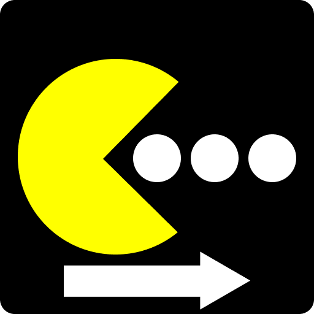

<div align="center">
    
    <h1>PacHelp</h1>
    <p> A Pacman and AUR (paru/yay) helper.</p>
</div>

<br>

## What is PacHelp
As said above, it is a `pacman` and AUR helper through `paru` or `yay` through a GUI instead of a CLI. Why a GUI? Because I fucking despise CLI.


## Download the binary
Download it from here: [nightly.link](https://nightly.link/daveberrys/pachelp/workflows/build.yaml/master/PacHelp-Linux.zip)

## Compiling from Scratch
Ensure you have `rust`, and `cargo` installed.

```bash
git clone https://github.com/daveberrys/pachelp
cd pachelp
cargo build --release --target x86_64-unknown-linux-gnu
chmod +x ./target/x86_64-unknown-linux-gnu/release/PacHelp
./target/x86_64-unknown-linux-gnu/release/PacHelp
```

# LICENSE
This project is under the [MIT License](LICENSE).